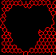
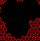
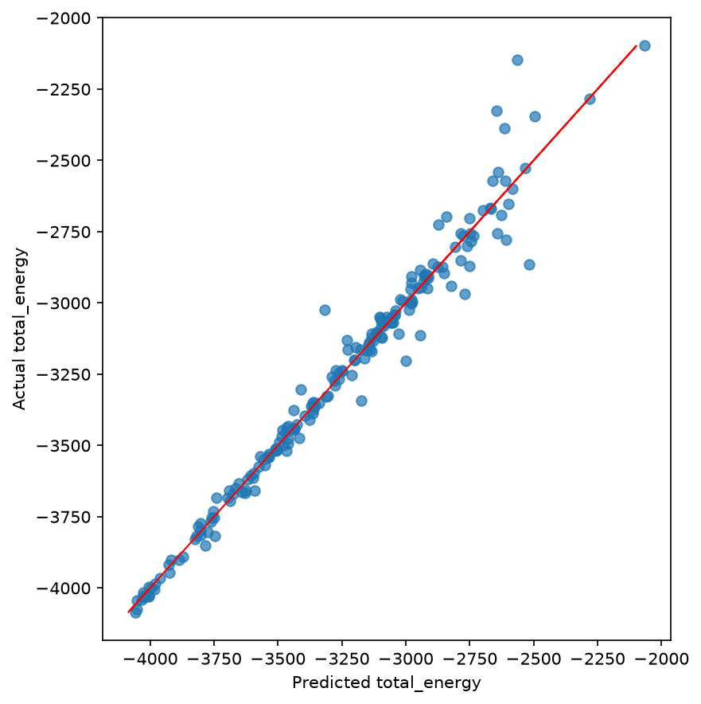
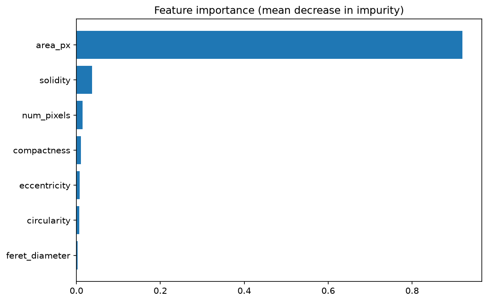
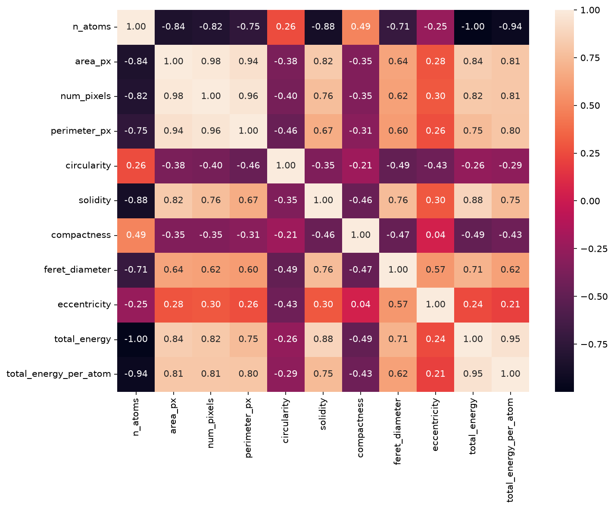

# Graphene Defect Detector

[](LICENSE)

Predicting the **total energy** of simulated nanographene samples from the
geometry of their structural defects, using YOLOv8 object detection, OpenCV
shape analysis, and gradient-boosted regression.

Graphene's exceptional properties come from its 2D honeycomb lattice, but
real samples are rarely defect-free. This project asks whether a sample's
physical properties can be predicted directly from the *shape* of its
defects, automatically extracted from an image. Developed at **CNR-ISMN**
(Istituto per lo Studio dei Materiali Nanostrutturati); see
[`docs/thesis_summary.md`](docs/thesis_summary.md) for the full method and
[`docs/known_quirks.md`](docs/known_quirks.md) for a couple of documented
feature-computation quirks.

## Pipeline

```
.xyz atomic structure
        │  rendering       (chemfiles: guess bonds, draw them)
        ▼
  rendered PNG
        │  detection        (YOLOv8: detect + crop defect boxes)
        ▼
  defect crop(s)
        │  segmentation     (OpenCV: highlight the void)
        ▼
  defect mask(s)
        │  features         (OpenCV: area, perimeter, circularity, ...)
        ▼
  per-defect shape features
        │  dataset          (aggregate per sample, attach total_energy)
        ▼
  modeling dataset  ──►  modeling.train_regressor  ──►  total_energy prediction
```

<p align="center">
  
  &nbsp;→&nbsp;
  
  &nbsp;→&nbsp;
  
</p>

## Results

A `GradientBoostingRegressor` trained on 7 area-weighted shape descriptors
(area, pixel count, circularity, solidity, compactness, Feret diameter,
eccentricity) of ~2000 samples' defects predicts `total_energy` with
**R² ≈ 0.97** on a held-out test set.

<p align="center">
  
  
  
</p>

## Installation

```bash
git clone https://github.com/Gabrocecco/GrapheDefectDetector.git
cd GrapheDefectDetector

conda env create -f environment.yml
conda activate graphene-defect-detector
pip install -e ".[dev]"
```

Runs on Linux and Windows. Without conda, any Python ≥3.10 virtualenv +
`pip install -e ".[dev]"` works too.

## Quickstart

```bash
gdd run-pipeline --limit 50   # render -> detect -> segment -> build dataset
gdd train --dataset data/tables/energy_dataframe.csv --model-out models/regressor.joblib
```

All paths come from [`configs/pipeline.yaml`](configs/pipeline.yaml). See
`gdd --help`, or [`notebooks/demo.ipynb`](notebooks/demo.ipynb) for an
annotated walkthrough with plots, and
[`notebooks/train_yolo.ipynb`](notebooks/train_yolo.ipynb) to retrain the
detector.

## Project layout

```
src/graphene_defect_detector/   rendering, detection, segmentation, features, dataset, modeling, plots, cli
configs/                        pipeline.yaml, yolo_dataset.yaml
data/                           .xyz inputs + every intermediate pipeline artifact (see data/README.md)
models/                         YOLOv8 weights (see models/README.md)
notebooks/                      demo.ipynb, train_yolo.ipynb
tests/                          pytest suite
docs/                           known_quirks.md, thesis_summary.md
```

## Testing & linting

```bash
pytest
ruff check src tests && black --check src tests && mypy src/graphene_defect_detector
```

## Citation

If you use this work, please cite the original thesis (see
[`CITATION.cff`](CITATION.cff)):

> Ceccolini, G. (2023). *Modelli Predittivi basati su Computer Vision per
> Proprietà Fisiche di Nanografene*. Alma Mater Studiorum – Università di
> Bologna.

## Acknowledgments

Thesis advisor Prof. Paolo Bellavista (University of Bologna); internship
supervisor Dr. Francesco Mercuri and the DAIMON research group at CNR-ISMN.

## License

[MIT](LICENSE)
